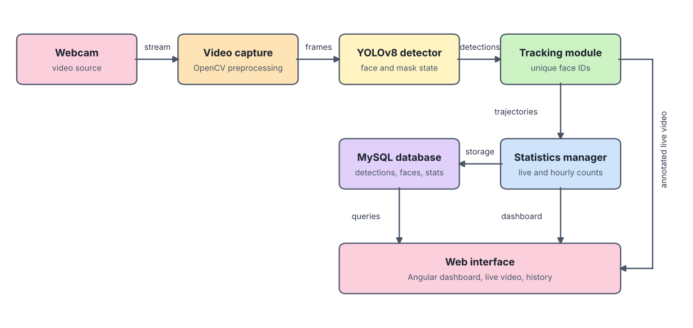

<div align="center">

# Mask Detection System using YOLOv8

**Real-time face mask detection with tracking, live dashboard and history**


Year project (PFA), Polytech Monastir, 2024/2025
Supervised by Dr. Mohamed Amine Omrani

</div>

---

## Overview

This project detects, in real time, whether people in a video stream are wearing a face mask. Each face is classified into one of three states: **with mask**, **without mask** or **incorrect mask**. A tracking module gives every face a unique ID, so a person who stays in view is counted once rather than on every frame.

Results are shown in a web interface with the annotated live video, real-time counters and a searchable history of past detections. The system runs locally and is built for places such as hospitals, schools and transport hubs.

## Features

- Real-time detection and classification with YOLOv8
- Webcam integration for live detection
- Three mask states: with mask, without mask, incorrect mask
- Face tracking with unique IDs to avoid double counting
- Annotated video with color-coded bounding boxes and labels
- Real-time counters per category, updated on every frame
- Hourly statistics and a detection history that can be filtered by date, time and camera
- Web interface for monitoring and control

## Architecture

<div align="center">

</div>

Each frame follows the same path: the webcam feeds the capture module, which resizes and normalizes the image with OpenCV. YOLOv8 detects faces and classifies the mask state, and the tracking module assigns persistent IDs. The statistics manager updates live and hourly counters and stores them in MySQL. Live updates reach the Angular interface over WebSocket, while history and configuration use REST requests.

| Layer | Technologies |
|---|---|
| Back end | Python, Flask (REST API), Flask-SocketIO (WebSocket), OpenCV, YOLOv8, SQLAlchemy |
| Front end | Angular, TypeScript, RxJS, Angular Material, ng-charts, Socket.IO client |
| Database | MySQL 8.0 |
| Tooling | Git, Node.js and npm, VS Code, Docker Compose and Nginx for deployment |

### Data model

| Table | Purpose |
|---|---|
| `DETECTION_HISTORY` | Per analyzed frame: counts of faces with, without and with an incorrect mask, image path, confidence score |
| `HOURLY_STATS` | Hourly aggregation of the detection counts, for fast time-range queries |
| `TRACKED_FACE` | One row per tracked face: first and last seen, mask state, confidence, missed frames |
| `SYSTEM_STATS` | Periodic machine metrics: processing time, FPS, memory and GPU usage |

## Design targets

The specification set these targets for the system:

- At least 15 frames per second under normal conditions, with a maximum of 100 ms latency per frame
- Up to 50 faces processed simultaneously
- Fully local processing, with no cloud dependency
- Responsive web interface that loads in under 2 seconds

## Why YOLOv8

YOLOv8 was chosen for its balance of accuracy, speed and model size, and for its mature ecosystem (Python API, ONNX and TensorRT export, active documentation). It comes in nano, small and medium variants, which lets the accuracy and speed trade-off be adjusted to the available hardware. YOLOv10 was considered but gave only a small accuracy gain at the cost of lower throughput and a larger model, and had less industrial track record at the time.

The comparison below reports figures from the published sources cited in the project report. They were not measured in this project.

| Model (MaskedFace-Net) | mAP50 (%) | FPS (GPU) | Size (MB) |
|---|---:|---:|---:|
| YOLOv8 nano | 82.5 | 90 | 7 |
| YOLOv8 small | 87.1 | 60 | 14 |
| YOLOv8 medium | 89.3 | 45 | 27 |
| SSD-MobileNet | 77.1 | 30 | 98 |
| RetinaNet | 80.2 | 20 | 145 |
| Faster R-CNN | 82.4 | 5 | 500 |

## Project structure

```
mask-detector-yolo/
├── backend/
│   ├── app.py              # Flask backend server
│   ├── mask_detector.py    # YOLO mask detection logic
│   ├── requirements.txt    # Python dependencies
│   └── data/
│       └── models/         # YOLO model weights
├── frontend/
│   ├── src/
│   │   ├── app/
│   │   │   ├── components/ # Video feed, dashboard and history components
│   │   │   └── services/   # API and WebSocket services
│   │   └── assets/         # Static assets
│   └── package.json        # Frontend dependencies
└── README.md
```

## Prerequisites

- Python 3.8+
- Node.js and npm
- Angular CLI
- MySQL 8.0+
- A webcam
- NVIDIA GPU with CUDA (recommended for real-time performance)

## Installation

### Backend

1. Create and activate a virtual environment:

```bash
python -m venv venv
source venv/bin/activate  # On Windows: venv\Scripts\activate
```

2. Install the dependencies:

```bash
cd backend
pip install -r requirements.txt
```

3. Create a MySQL database for the project. The database connection and the model configuration are set through environment variables.

### Frontend

```bash
cd frontend
npm install
```

## Usage

Start the backend:

```bash
cd backend
python app.py
```

The backend is available at `http://localhost:5000`.

Start the frontend in a second terminal:

```bash
cd frontend
ng serve
```

The frontend is available at `http://localhost:4200`.

The interface has three views: the live video stream, real-time statistics, and the detection history.

## Communication

- **WebSocket (Socket.IO):** live counters and dashboard updates
- **MJPEG stream:** annotated video feed shown in the interface
- **REST API:** paginated detection history, filtering, export and configuration

## Limitations

- One active video source at a time
- Up to 50 faces tracked simultaneously
- Local deployment only

## Future work

- Model optimization (smaller parameter count, quantization) and continual learning
- Multi-camera support
- Thermal detection
- Automatic report generation
- Cloud deployment and a third-party API, to offer the system as a service

## License

This project is licensed under the MIT License. See the `LICENSE` file for details.

## Acknowledgments

- YOLOv8 by Ultralytics
- OpenCV for computer vision operations
- Flask for the backend framework
- Angular for the frontend framework

## Author

Senda LAATAOUI,
AI Researcher | Explainable AI & Medical Imaging | Deep Learning Engineer
[LinkedIn](https://www.linkedin.com/in/senda-laataoui/)
